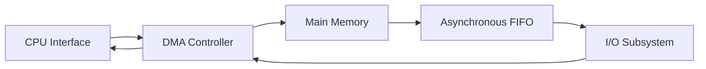
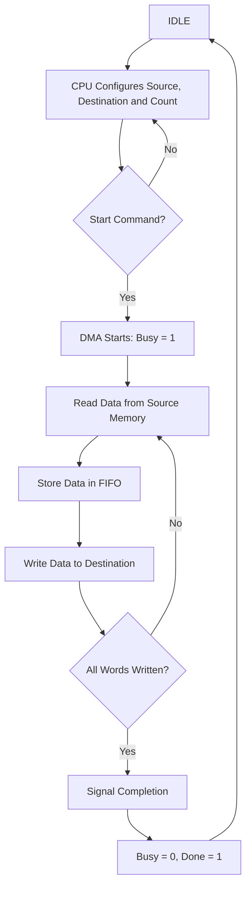

# Mini DMA Controller with Asynchronous FIFO

## Overview

This project implements a Mini DMA (Direct Memory Access) Controller using Verilog HDL.

The DMA controller transfers data between main memory and I/O blocks without requiring the CPU to handle every data word individually. An asynchronous FIFO temporarily stores data between the read and write clock domains.

The design is simulated using AMD/Xilinx Vivado.

## Features

- 32-bit data and address width by default
- Memory-to-memory and memory-to-I/O transfers
- Asynchronous FIFO with a default depth of 16 words
- Separate system and I/O clocks
- Source and destination address counters
- Configurable transfer count
- Busy and Done status flags
- Verilog testbench for functional verification

## Block Diagram

## DMA Control Flow (FSM-Style)

The DMA controller uses separate read-side and write-side control logic. The current RTL does not use one explicit encoded FSM; it uses control flags, counters, and clock-domain synchronization.

The following diagram shows its functional operation.

### How It Works

1. The CPU sets the source address, destination address, and transfer count.
2. The CPU sends the Start command.
3. The DMA reads data from the source when the source is ready and the FIFO is not full.
4. The FIFO temporarily stores the data.
5. The DMA writes data to the destination when data is available and the destination is ready.
6. The source and destination addresses advance by 4 bytes after each successful word transfer.
7. After the final destination write, the DMA reports completion to the CPU.

The read and write sides can operate independently using different clocks.

## DMA Register Map

| CPU Address | Register | Function |
|---|---|---|
| `0x00000000` | SRC_ADDR | Source address |
| `0x00000004` | DST_ADDR | Destination address |
| `0x00000008` | COUNT | Number of words to transfer |
| `0x0000000C` | CONTROL/STATUS | Start command and status flags |

The status register uses bit 0 for Busy and bit 1 for Done.

## Project Files

| File | Description |
|---|---|
| `dma_system.v` | Top-level system |
| `dma_controller.v` | DMA control and address counters |
| `async_fifo.v` | Asynchronous FIFO |
| `memory_subsystem.v` | Main memory model |
| `io_subsystem.v` | I/O memory model |
| `tb_dma_system.v` | Simulation testbench |
| `mem_init/` | Optional memory initialization files |

## Example Transfer

For a transfer of 16 words:

- Source address: `0x2000`
- Destination address: `0x1000`
- Transfer count: `16`

The DMA attempts to transfer data from main memory to I/O 0. The testbench checks the destination data against the expected values.

## How to Run in Vivado

1. Create a new RTL project in Vivado.
2. Add the five design files under **Design Sources**.
3. Set `dma_system` as the design top module.
4. Add `tb_dma_system.v` under **Simulation Sources**.
5. Set `tb_dma_system` as the simulation top module.
6. Check memory initialization filenames if `$readmemh` is enabled.
7. Select **Run Simulation → Run Behavioral Simulation**.
8. Click **Run All** and check the simulation log for the final result.

## Tools Used

- Verilog HDL
- AMD/Xilinx Vivado
- Behavioral Simulation

## Conclusion

This project demonstrates DMA-based data transfer, asynchronous FIFO buffering, memory-mapped registers, clock-domain synchronization, and Verilog testbench verification.

The final data-transfer functionality must be confirmed through successful simulation results.
